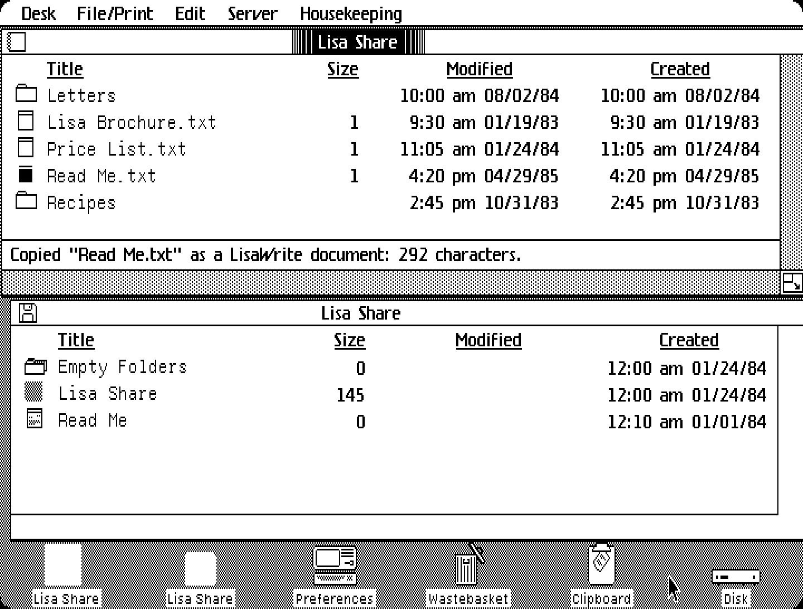
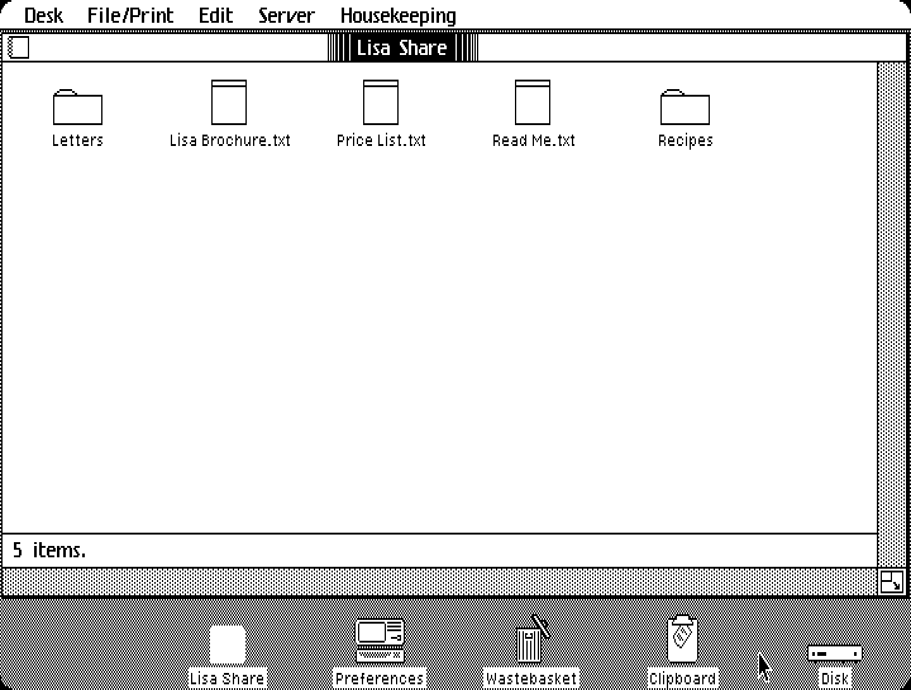
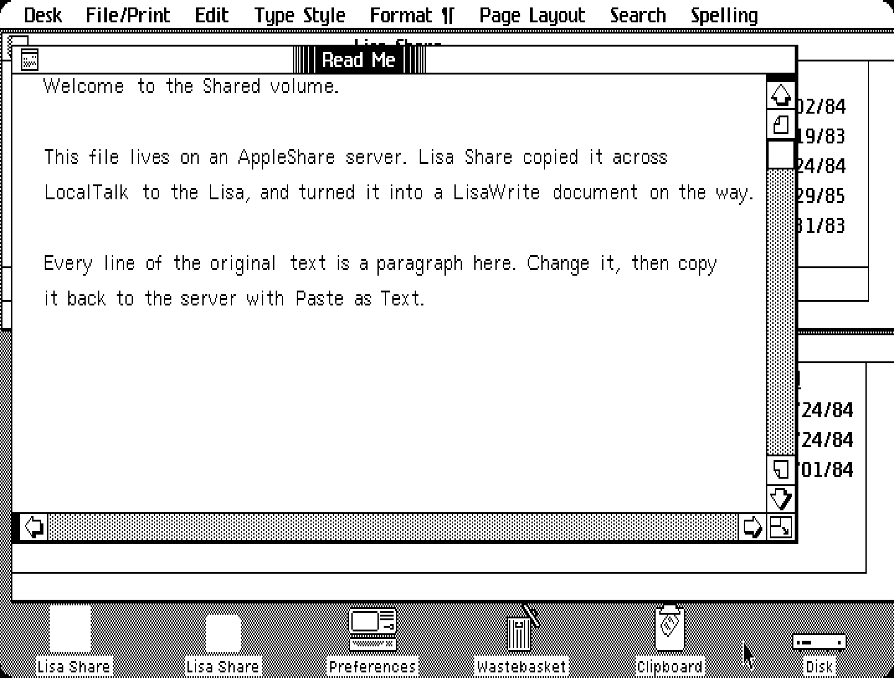

# Lisa Share

AppleShare file sharing for the Apple Lisa Office System (LOS 3.x). Lisa Share
is a desktop tool on one floppy. It connects the Lisa to AppleShare (AFP)
servers over LocalTalk on Serial B, so you can browse their volumes and copy
files between a server and the Lisa desktop. It's written in C and
cross-compiled with [lisa-c](https://github.com/pappadf/lisa-c); it runs on the
LOS desktop (tested in the granny-smith emulator).



*A folder on the server (above) and the Lisa's diskette (below), both in the
Desktop Manager's list view. "Read Me.txt" has just been copied from the server
as a LisaWrite document. Shown at the Lisa screen's true aspect ratio: the 720
x 364 screen with each pixel 2 wide and 3 tall, because Lisa pixels are about
1.5 times taller than wide.*



*Housekeeping > Pictorial View: the same folder as icons, as in a disk window.*



*The copied document, open in LisaWrite.*

**Try it in your browser:** [pappadf.github.io/lisa-share](https://pappadf.github.io/lisa-share/)
boots a Lisa in the granny-smith emulator with the latest release's floppy in
the drive. The emulator has an AppleShare server of its own, **Shared
Folders**. Its volume **Shared** is the folder `/opfs/shared` in the
emulator's Filesystem panel: drop some files there to have something to copy.

## Quick start

On Linux (x86_64 or arm64) with git, make, Python 3, curl, unzip, meson and
ninja:

```bash
git clone --recursive https://github.com/pappadf/lisa-share
cd lisa-share
make toolchain    # once: download lisa-c's prebuilt compiler
make serve        # build, then print a link to open in your browser
```

The link opens granny-smith (the emulator's web build) with the Office System
3.1 started and the Lisa Share floppy in the drive. On the Lisa desktop, open
the **Lisa Share** diskette, then the **Lisa Share** tool in it.

The first `make` also builds picolibc for the 68000, which takes a minute or
two.

## Using Lisa Share

1. **Open the tool.** Lisa Share is a tool without stationery, like the
   Calculator: you open the tool itself, and it is one window, which Set Aside
   turns back into the tool's icon. While it runs it uses Serial B for
   LocalTalk, and when it ends it gives the port back to the serial driver.
   (Serial B must be on a LocalTalk network. In granny-smith it always is.)
2. **Find a server.** Choose **Server > Find Servers**. Select a server and
   choose **Server > Open** (or double-click) to log in as a guest. Then open
   a volume and folders the same way; **Server > Go Up** goes back.
3. **Choose a view.** The window looks like a Desktop Manager disk or folder,
   with the same icons, and the **Housekeeping** menu has the same views:
   **Pictorial View** (icons), **Alphabetical View** and **Chronological
   View** (a list with Title, Size in blocks, Modified and Created). A status
   line at the bottom says where you are and what happened.
4. **Server to Lisa:** select a file and choose **Edit > Copy**. Then select a
   disk or folder on the desktop and choose **Edit > Paste**. The file arrives
   as a Mac file document, which keeps both forks and the Finder information.
   Opening it shows the information and the start of its text.
5. **Lisa to server:** select a document on the desktop and choose **Edit >
   Copy Reference**. Then, in the Lisa Share window, open the folder to copy it
   to and choose **Edit > Paste**.
   - A Mac file document becomes the Mac file it was.
   - Any other Lisa document (LisaWrite, LisaCalc, ...) is copied as it is, into
     a folder "*name*.lisa". The folder holds the document's files and a
     MANIFEST naming the owning tool and each file's label. Lisa Share shows
     such a folder as a document: Copy and Paste it onto the desktop to get
     the document back, owned by its own tool.
   - A file or folder with the same name is kept, and the copy gets a number
     ("name 2").
6. **Converting** is always a separate command, never implicit.
   - **Edit > Copy as LisaWrite** works on a text file selected in the browser,
     or on an open Mac file document. Paste it into a disk or folder to get a
     LisaWrite document holding the text: one paragraph per line, in
     LisaWrite's standard format.
   - **Edit > Paste as Text** in the browser takes LisaWrite documents from the
     Clipboard (Copy Reference on the desktop) and copies their text to the
     server as text files (type TEXT, creator ttxt, CR line ends).

## How it works

- **One tool and one floppy, with nothing to install.** When the tool first
  uses the network, it copies its LocalTalk driver to the boot disk and
  attaches it to Serial B in place of the serial driver (or to the empty
  port). When it ends, it puts the port back as it was. It uses the OS's
  configurable-driver calls `CDINFO`, `CDKILL`, `CDMAKE` and `MOUNT`, so there
  is no Preferences step and parameter memory is not changed.
- **The driver,** `SYSTEM.CD_ATALK`, is a LOS configurable driver written in C.
  It runs Serial B as SDLC at 230.4 kbit/s (the Lisa's port B has the RS-422
  drivers and the 3.6864 MHz clock that AppleBus needs), acquires a node
  address, and answers the LLAP RTS/CTS handshake from its interrupt code.
- **The protocol stack** runs inside the tool, in C: DDP, NBP, ATP, ASP and an
  AFP 2.0 client (`lib/`).
- **Copying uses the Office System's own Clipboard icon references,** so the
  Desktop Manager needs no changes. Pasting a reference from Lisa Share makes
  the Desktop Manager create the document and ask Lisa Share to write it.
- **Mac files copied as they are** become "Mac file" documents owned by Lisa
  Share. They keep the data fork, the resource fork and the Finder info, so
  they go back to a Mac unchanged.

The design, and what was found out about LOS on the way, is in
[docs/architecture.md](docs/architecture.md).

## Building and running

lisa-c comes in as a git submodule (`lisa-c/`, pinned to the version Lisa
Share is tested with):

```bash
git clone --recursive https://github.com/pappadf/lisa-share
cd lisa-share
make toolchain    # once: lisa-c's prebuilt compiler (Linux x86_64 or arm64)
make
```

`make` writes `build/lisashare.dc42`: a floppy with the tool (`{T22}obj`,
`{T22}PHRASE`) and its driver (`SYSTEM.CD_ATALK`).

If you already have a lisa-c clone next to this directory and no submodule,
that's used instead (or set `LISA_C=/path/to/lisa-c`).

```bash
make serve          # run it yourself: granny-smith in your browser, LOS 3.1 booted with
                    # the Lisa Share floppy in the drive (prints the address to open)
make test           # the probes and the tool's round trips in granny-smith; PASS/FAIL
make demo           # a scripted session (build/demo/*.png)
make screenshots    # ... and docs/*.png from it
make driver         # the LocalTalk driver alone: build/atalk.drv
```

`make serve` downloads granny-smith's web build from its GitHub releases (once)
and serves everything from a local web server; in a GitHub Codespace it prints
the forwarded address too. It needs granny-smith v0.9.4 or later, the first
release whose Lisa has Serial B on the emulator's AppleTalk network. It uses
your own Lisa ROM and Office System disk when you have them (`LISA_ROM`, a Lisa
2 boot ROM, rev H, and `LOS_IMAGE`, Office System 3.1 on a ProFile, or the same
files in `lisa-c/media/`), and otherwise the archive.org copies (the Office
System with the seven Lisa applications).

`make test` and `make demo` are scripted runs in granny-smith's headless
emulator: they need `GS_HEADLESS` and your own files (see `lisa-c/emu/env.sh`).
The tests publish a share on the emulator's network with
`appletalk.afp.volumes.add`. The demo's last screenshot needs an Office System
disk with LisaWrite.

To move to a newer lisa-c: `git -C lisa-c pull`, check that everything still
works, then commit the new `lisa-c` pointer.

## Releases

Pushing a version tag (`git tag v0.1 && git push origin v0.1`) runs
`.github/workflows/release.yml`. It builds the floppy, attaches it to the
GitHub release as `lisashare-<tag>.dc42`, and publishes it on GitHub Pages:

- `https://pappadf.github.io/lisa-share/lisashare.dc42` is the latest floppy.
  Pages sends CORS headers, so granny-smith's web build can load it with
  `FD0=<that URL>`.
- `https://pappadf.github.io/lisa-share/` is a page with a Boot link
  (`tools/pages.py`).

The first time, set the repository's Settings > Pages > Source to "GitHub
Actions". Then, under Settings > Environments > github-pages, add `v*` to the
deployment branches and tags: by default only `main` may deploy, and this
workflow runs on tags.

## Source

| Path | What |
|---|---|
| `tool/main.c` | Startup, event loop, menus, the Desktop Manager (Filer) protocol |
| `tool/browser.c` | The browser: servers, volumes, folders; copying in both directions |
| `tool/view.c` | The window, drawn as a Desktop Manager disk window: the three views, scroll bars, size control |
| `tool/macfile.c`, `lisadoc.c`, `lisawrite.c` | Mac file documents, any Lisa document's files, LisaWrite documents |
| `tool/lisashare.phrase` | Menus and alerts |
| `driver/atalk.c` | `SYSTEM.CD_ATALK`, the LocalTalk (LLAP) driver for Serial B |
| `lib/` | The AppleTalk stack: installing the driver (`atk_link.c`), DDP, NBP, ATP, ASP, the AFP client. `atk.h` is its interface; `atalk_api.h` is the driver's |
| `probes/` | Test tools, one per assumption or layer, and their shared skeleton (`common/`) |
| `tests/` | Emulator scripts for the tests, and the demo session (`demo.sh`) |
| `demo/share/` | The files the demo session shares |
| `tools/` | `lwmake.py` / `lwtext.py` (LisaWrite documents, for the tests), `longtext.py`, `aspect.py` (screenshots), `pages.py` |
| `docs/` | The design, and the screenshots |

## Probes

Probes are small desktop tools, in `probes/`, that each check one assumption
about LOS on the real Office System. Each shows its steps in its window and
writes them to a `<NAME>.RESULTS` file on its floppy, which `make test` reads
back.

| Probe | What it checks | Result |
|---|---|---|
| `serialb` | Can a tool take over Serial B at run time? It reads the port with `CDINFO`, detaches the driver with `CDKILL`, then attaches it again with `CDMAKE` and the saved info, and mounts it. | **Yes.** Serial B is held by a configurable driver, ID 32 (the "Serial Cable" driver), not a built-in one. `CDKILL` succeeds, after which `CDINFO` reports 751 (no device). `CDMAKE` restores the same driver, and `MOUNT` makes it usable again (`CDKILL` unmounts the device, and `CDMAKE` does not mount it). |
| `llap` | Does the LocalTalk driver work? It installs `SYSTEM.CD_ATALK` at Serial B, acquires a node ID, acquires again starting at 33 (taken by the emulator's node), sends an AppleTalk Echo request to node 33 and reads the reply. | **Yes, in the emulator.** The driver gets a node ID; at 33 the lapACK makes it pick another. The echo request goes out with lapRTS/lapCTS. The driver's interrupt code answers the network's lapRTS with a lapCTS and queues the echo reply. |
| `nbp` | Can the stack find services? It looks up `=:=@*` and `=:AFPServer@*`. | **Yes.** All three of granny-smith's entities: "Shared Folders" (AFPServer, node 33 socket 8), "Virtual LaserWriter" and "gs-host". |
| `afp` | Can the stack read a file from an AppleShare server? NBP lookup, ASP GetStatus and OpenSession, then AFP FPLogin (guest), FPGetSrvrParms, FPOpenVol, FPEnumerate, FPOpenFork and FPRead. | **Yes.** It reads "Hello from the AppleShare server!" (the read ends with EOFErr, as it should). |
| `paste` | Can a tool create a document on the desktop? It puts an icon reference on the Clipboard; the test pastes it into the diskette with the Desktop Manager's Edit > Paste. | **Yes.** The Desktop Manager makes the catalog entry, owned by the probe's tool number, then sends the tool fcCopy with the new document's file prefix, and the tool writes the file. The tool has to set its own window aside first, so that the disk's window is in front. |

## Not yet

- **MacWrite to LisaWrite,** and keeping formatting when converting.
- **Real hardware.** The driver's timing has only been tested in the emulator.
- **Logging in with a name and password.** Lisa Share logs in as a guest.
- **Custom icons** for the tool and its documents (they use the generic ones).
- **Large folders.** The browser shows the first 40 items of a folder.

## A Note on AI

This project allows the use of AI. That isn't limited to code generation or
code review: it also covers documentation and research into how the Lisa
Office System works.
There is no intention to track, at the file or commit level, which code was
written with AI assistance and which wasn't. I know that AI may be a red flag
for some people, and I fully respect that.

## Trademarks

All trademarks referenced in this project are the property of their respective owners and are used for identification purposes only. This project does not claim any endorsement by or affiliation with the trademark holders.

## License

MIT; see `LICENSE`. No Apple software is included or needed to build. Running
needs a Lisa ROM and an Office System disk: your own, or the archive.org copies
the browser link uses.
